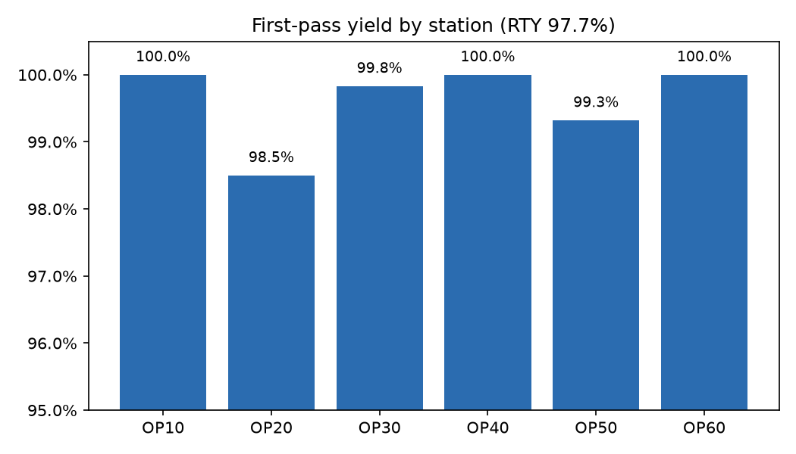
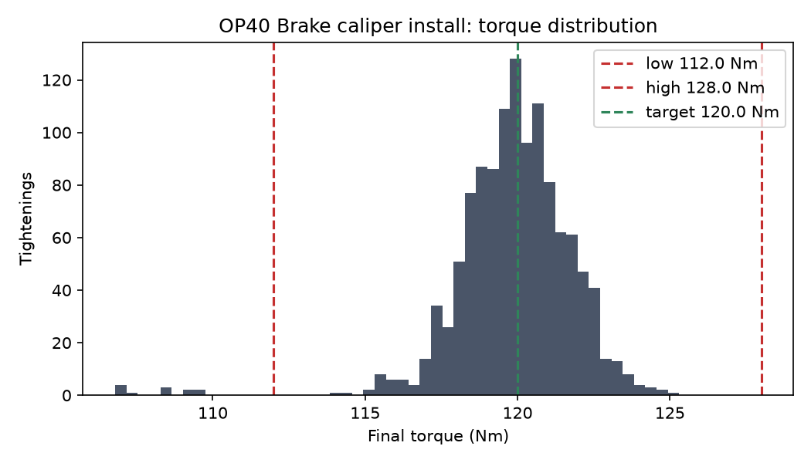
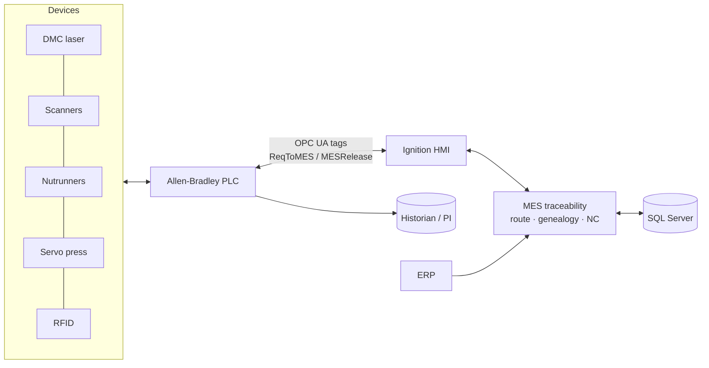

# Automotive MES Production Traceability

A working **discrete-manufacturing MES traceability system** for an automotive assembly line. It covers serialization, routing interlocks, part validation (error-proofing), torque and press validation, non-conformance and rework, andon, RFID packing, full **product genealogy**, and **supplier-lot containment**. It is modelled on the MES/SCADA work I supported as an MES Engineer at **Aztec Technologies** (Jun 2021 – Aug 2023).

> ⚠️ **Portfolio reconstruction, no proprietary content.** The product (FSM-200 front suspension module), part numbers, lots and production data are fictitious. No Aztec Technologies or customer code, configuration or data is included. On the real line this logic ran in Rockwell FactoryTalk MES with Ignition, Allen-Bradley PLCs and OPC UA. Here it is re-implemented in Python + SQL so it can be run and reviewed by anyone.

   

---

## What it does

| Capability | Detail |
|---|---|
| **Serialization** | DMC serial per knuckle (`FSMyymmddNNNNN`, ISO/IEC 15434 payload) |
| **Routing interlocks** | PLC ↔ MES handshake. A station releases only if every previous op is OK, the unit is not on hold and not scrapped |
| **Error-proofing** | Part-number vs variant BOM check, duplicate-component check, held-lot check at every scan |
| **Torque validation** | Torque **and** angle windows per bolt, one re-hit allowed, then non-conformance |
| **Press validation** | Force and depth window for the hub-bearing press |
| **NC & rework** | Automatic NC hold, quality andon, rework/scrap disposition, return to the failed op |
| **Genealogy** | Serial → bearing / caliper part number, lot and serial; full "birth history" |
| **Containment** | Hold a supplier lot → every affected serial, rack and RFID in one query; new use blocked |
| **Packing** | Rack assignment and RFID EPC per unit |
| **KPIs** | First-pass yield per station, rolled throughput yield, torque first-hit rate, NC Pareto |

## Simulation results (600 units, one production week)

```bash
python simulate.py --units 600
```

| KPI | Result |
|---|---|
| Packed first time | 586 |
| Packed after rework | 6 |
| Scrapped | 8 |
| **Rolled throughput yield** | **97.7%** |
| Torque first-hit OK rate | OP30 99.2% · OP40 99.0% |
| Wrong-variant calipers caught at scan | 5 |
| Andon events | 21 |
| **Containment of lot L-CAL-2207** | **148 units in 14 racks found in one query; further use blocked** |

| First-pass yield by station | OP40 torque distribution |
|---|---|
|  |  |

Evidence: [KPI summary](output/kpi_summary.json) · [Containment report](output/containment_report.csv) · [Example birth history](output/birth_history_example.md) · [OPC UA tag snapshot](output/opcua_tag_snapshot.json)

## Architecture



Details: [Architecture & handshake](docs/Architecture.md) · [OPC UA tag map](docs/OPC_UA_Tag_Map.md)

## Documentation

| Document | Content |
|---|---|
| [Architecture](docs/Architecture.md) | ISA-95 landscape, PLC↔MES sequence diagram, station list |
| [Functional Spec: Interlocks](docs/Functional_Spec_Interlocks.md) | 13 functions, each traced to code and tests |
| [OPC UA Tag Map](docs/OPC_UA_Tag_Map.md) | Handshake and process tags, MES reason codes |
| [Ignition HMI Screen Spec](docs/Ignition_HMI_Screen_Spec.md) | Line overview, station, rework and traceability screens |
| [Test Scripts & Containment](docs/Test_Scripts_and_Containment.md) | SAT scripts and the supplier-lot containment procedure |

## Repository layout

```
├── config/route_FSM-200.json   # product routing, variants/BOM, process windows
├── mes/
│   ├── traceability.py         # MES core: serialize, interlock, scan, torque, press, NC, pack, containment
│   └── plc.py                  # OPC UA-style tag server + PLC↔MES handshake
├── sql/
│   ├── schema.sql              # unit, station_result, genealogy, torque/press, NC, lot_hold, andon
│   └── traceability_queries.sql# birth history, containment, FPY, torque first-hit, NC Pareto
├── simulate.py                 # one-week line simulation -> output/
├── tests/test_traceability.py  # 15 tests
└── docs/
```

## Run it

```bash
git clone https://github.com/saivamsi462000/automotive-mes-traceability.git
cd automotive-mes-traceability
python -m venv .venv && source .venv/bin/activate
pip install -r requirements.txt
python simulate.py
pytest -v
```

## Skills and tools

Rockwell FactoryTalk MES concepts · Ignition Perspective/Vision · Allen-Bradley ControlLogix/CompactLogix · OPC UA · barcode/DMC/RFID · torque-tool integration · production routing · serial tracking · genealogy · non-conformance/rework · andon · SQL Server · Python

## Author

**Gopi Satya Sai Vamsi** · [LinkedIn](https://www.linkedin.com/in/sai-vamsi-2740621ab/) · [GitHub](https://github.com/saivamsi462000)
