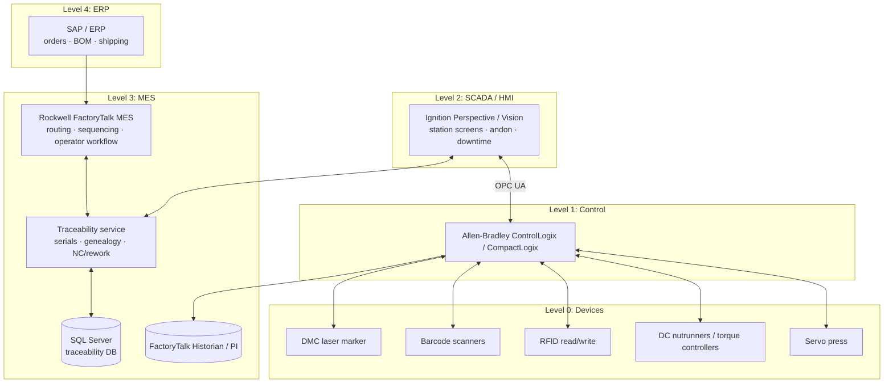
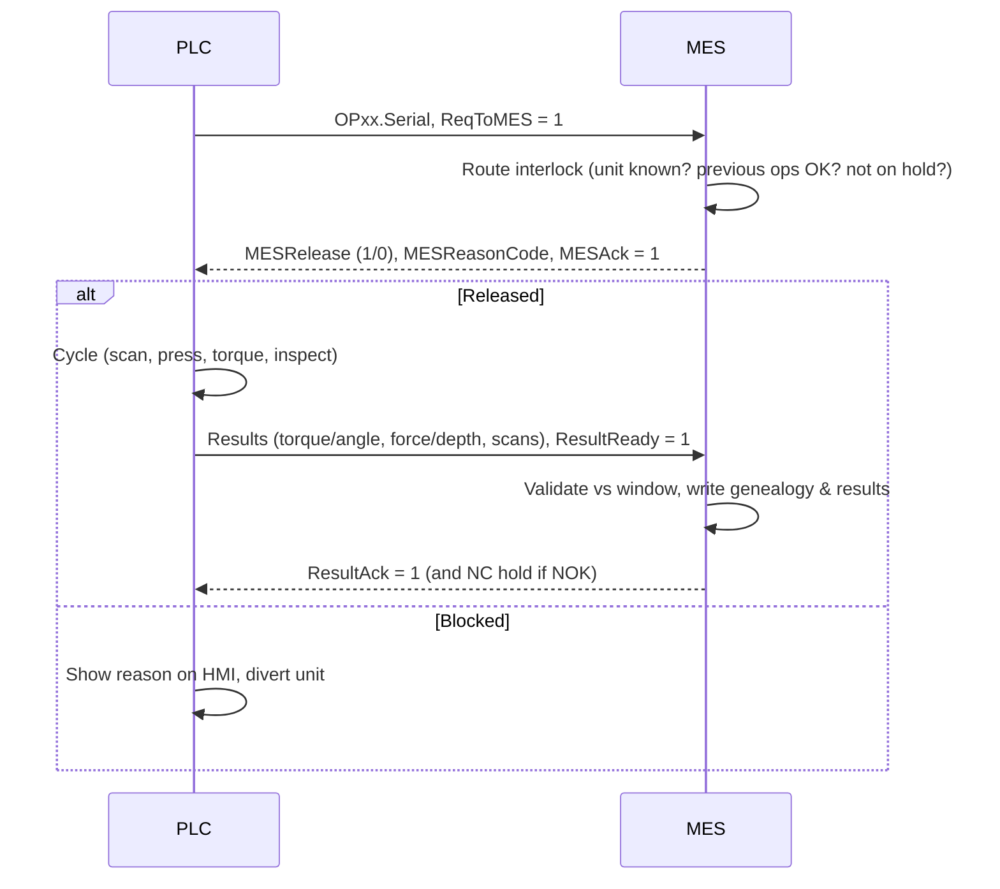

# Architecture: Automotive Assembly MES & Traceability

## ISA-95 landscape

## Station handshake (per operation)

## Line layout: FSM-200 front suspension module

| Op | Station | Equipment | Data captured |
|---|---|---|---|
| OP10 | Knuckle load & serialize | Laser marker, DMC verifier | Serial, DMC grade |
| OP20 | Hub bearing press | Servo press, scanner | Bearing PN/lot/SN, force, depth |
| OP30 | Strut clamp bolt torque | 2-spindle nutrunner | Torque + angle per bolt, attempts |
| OP40 | Brake caliper install | Scanner, nutrunner | Caliper PN/lot/SN (variant check), torque + angle |
| OP50 | End-of-line inspection | Vision / manual checklist | Visual, orientation, DMC readability |
| OP60 | Pack & ship label | RFID writer, label printer | Rack ID, RFID EPC |
| RW01 | Rework bench | HMI | NC disposition, rework action, technician |

> This is a portfolio reconstruction with a fictitious product and data. It contains no Aztec Technologies or customer information.
